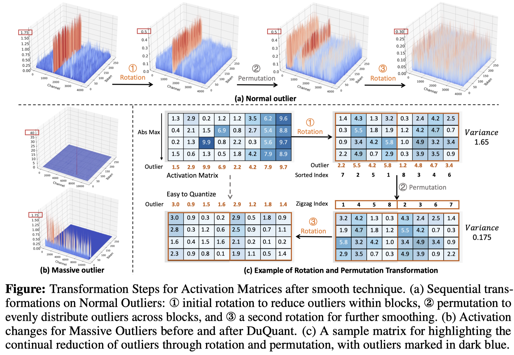
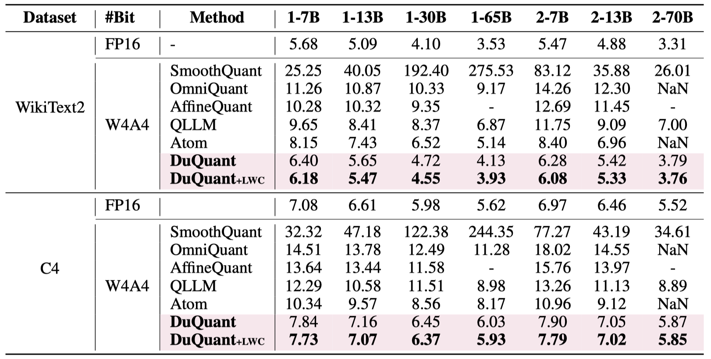
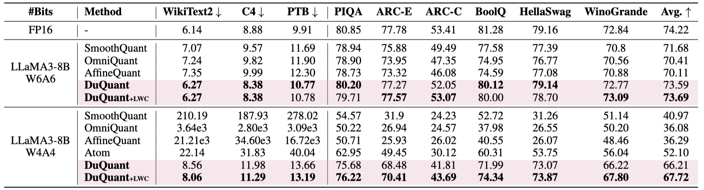

# DuQuant: Distributing Outliers via Dual Transformation Makes Stronger Quantized LLMs

<h5 align="center">

[](https://arxiv.org/abs/2406.01721)
[](https://duquant.github.io)
[](https://github.com/Hsu1023/DuQuant/blob/main/LICENSE)
 <br>

</h5>

[DuQuant++: Fine-grained Rotation Enhances Microscaling FP4 Quantization](https://arxiv.org/abs/2604.17789) is a new version of DuQuant that uses MXFP4 quantization format.

Welcome to the official code repository for "[DuQuant: Distributing Outliers via Dual Transformation Makes Stronger Quantized LLMs **(NeurIPS 2024, Oral)**](https://arxiv.org/abs/2406.01721)".

🔍 For more details, please refer to the project page: [https://duquant.github.io/](https://duquant.github.io/).


## 📰 News
* [2026/04/21] 🚀 We Release [DuQuant++](https://github.com/Hsu1023/DuQuant-v2) for MXFP4 quantization!
* [2024/09/26] 🌟 Our DuQuant paper has been accepted for a Oral presentation at NeurIPS 2024 (only top 1% out of 15,671 submissions)! 🎉 Cheers!
* [2024/09/06] 🔥 We release the code!
* [2024/06/03] 🚀 Our paper is available on arXiv!


## 👀 Introduction


- We firstly identify **Massive Outliers** existence at the **down_proj** layer of FFN module in recent LLMs.
- DuQuant proposes to use **Rotation transformation** and **Permutation transformation** to effectively eliminate both massive and normal outliers.
- DuQuant establishs new **state-of-the-art** baselines for 4-bit weight-activation quantization across various model types and downstream tasks.


## Ada INT4 inference

We implement an Ada (SM89) CUDA backend for DuQuant, including calibrated dual rotations and permutations, packed INT4 GEMM/GEMV, fused activation quantization/dequantization, and full-model inference. The transforms are loaded from calibrated checkpoints. Packed asymmetric KV4 stores two values per byte and reads the compressed cache directly during decoding.

| LLaMA-2-7B | End-to-end time ↓ | Speedup ↑ | Model storage ↓ | Peak allocated GPU memory ↓ | Peak memory reduction ↑ |
|---|---:|---:|---:|---:|---:|
| FP16 | 552.13 ms | 1.00× | 12.55 GiB | 13.23 GiB | — |
| DuQuant RTN W4A4KV4 | 207.62 ms | **2.66×** | 3.54 GiB | 3.90 GiB | **70.5%** |

Measured on one NVIDIA GeForce RTX 4090 (Ada), batch size 1, 1024-token prompt and 32 generated tokens, including all 32 decoder layers and the LM head. Values are medians of 10 repetitions with CUDA Graphs for both FP16 and INT4. Model loading, compilation and graph capture are excluded; output transfer is included. Peak memory includes capture/warmup allocation, including the graph pool. This measures the new RTN checkpoint used below. Model tensor storage is reduced by **71.8%**.

[Measurements and memory accounting](benchmarks/llama_reconstruct/performance/summary.json) · [Generation benchmark](benchmarks/bench_llama_reconstruct.py). The standalone backend is separate from the original `main.py` workflow.

## Hopper INT4 inference

We add a Hopper (SM90) backend behind the same interface and checkpoint format, selected automatically. Hopper has no INT4 Tensor Cores, so packed INT4 weights are widened to INT8 in registers for an INT8 `wgmma` GEMM with a fused dequantization epilogue. Decoding runs each linear (rotations, permutation, A4 quantization and INT4 GEMV) as a single kernel.

| LLaMA-2-7B | End-to-end time ↓ | Speedup ↑ | Model storage ↓ | Peak allocated GPU memory ↓ | Peak memory reduction ↑ |
|---|---:|---:|---:|---:|---:|
| FP16 | 180.25 ms | 1.00× | 12.55 GiB | 13.28 GiB | — |
| DuQuant RTN W4A4KV4 | 140.73 ms | **1.28×** | 3.55 GiB | 3.98 GiB | **70.1%** |

Measured on one NVIDIA GH200 120GB with the same protocol as the Ada table above.

[Measurements and memory accounting](benchmarks/hopper/performance/summary.json) · [Hopper backend details](duquant_cuda/HOPPER.md).

## W4A4KV4 evaluation

We align the quantization configuration with the comparison methods: symmetric per-channel W4, asymmetric per-token A4, Q16, and asymmetric KV4 with group size 128. We add layerwise reconstruction to learn foldable channel scales and W/A/K/V clipping while keeping DuQuant rotations and permutations fixed. The channel scales fold into existing weights. Both RTN and GPTQ exports use the learned clipping. Reconstruction uses 128 × 2048 WikiText-2 training tokens and 15 epochs per layer; evaluation data are not used for parameter selection.

All quantized rows below use real INT4 kernels and the same evaluation protocol. Only the new DuQuant checkpoints are shown. **PPL** is WikiText-2 test perplexity at sequence length 2048; all QA tasks are full zero-shot evaluations. **Avg.** is the unweighted mean of the seven QA columns.

| Model | Method | PPL ↓ | PIQA ↑ | ARC-E ↑ | ARC-C ↑ | BoolQ ↑ | HellaSwag ↑ | WinoGrande ↑ | LAMBADA ↑ | Avg. ↑ |
|---|---|---:|---:|---:|---:|---:|---:|---:|---:|---:|
| LLaMA-2-7B | FP16 | 5.472 | 78.40 | 69.32 | 40.61 | 71.10 | 72.95 | 67.09 | 73.92 | 67.63 |
|  | QuaRot | 6.430 | 74.97 | 67.42 | 38.74 | 68.44 | 68.35 | 63.61 | 70.83 | 64.62 |
|  | SpinQuant | 6.666 | 74.48 | 65.57 | 37.80 | 69.57 | 66.95 | 62.35 | 69.92 | 63.81 |
|  | FlatQuant | 5.774 | 77.37 | 69.02 | 38.31 | 68.90 | 70.78 | 65.90 | 72.91 | 66.17 |
|  | **DuQuant (RTN)** | 5.818 | 77.26 | 68.64 | 38.99 | 71.53 | 70.80 | 66.22 | 71.61 | 66.44 |
|  | **DuQuant (GPTQ)** | 5.791 | 76.71 | 67.97 | 38.74 | 71.10 | 70.70 | 66.30 | 71.96 | 66.21 |
| Qwen3-1.7B-Base | FP16 | 9.388 | 75.90 | 73.78 | 45.05 | 79.08 | 66.52 | 64.17 | 63.77 | 66.90 |
|  | QuaRot | 15.200 | 68.61 | 64.39 | 37.80 | 65.96 | 55.86 | 53.83 | 48.11 | 56.36 |
|  | SpinQuant | 14.180 | 68.61 | 67.63 | 38.99 | 66.88 | 55.40 | 56.35 | 48.55 | 57.49 |
|  | FlatQuant | 11.547 | 71.55 | 69.32 | 40.61 | 70.34 | 63.05 | 60.06 | 57.31 | 61.75 |
|  | **DuQuant (RTN)** | 10.700 | 72.36 | 71.89 | 43.00 | 75.11 | 62.09 | 62.27 | 57.66 | 63.48 |
|  | **DuQuant (GPTQ)** | 10.820 | 72.14 | 70.71 | 42.15 | 71.80 | 61.71 | 60.93 | 59.09 | 62.65 |

Accuracy values are percentages. ARC-C and HellaSwag use normalized accuracy; other tasks use accuracy. See the [shared evaluation protocol](benchmarks/qa_compare/README.md).

Quantization formats and scoring are matched; transform-learning procedures and budgets are method-specific. LLaMA-2 uses released SpinQuant/FlatQuant transforms, while Qwen3 uses local adaptations. FlatQuant uses its learned transforms with our common clipping-search/GPTQ pipeline, rather than its native quantizer defaults.

Both new DuQuant exports on both models match the independent integer reference exactly on 32 full-model likelihood requests. This checks the prefill path; [cached-decode rounding diagnostics](duquant_cuda/CALIBRATED.md#kv-modes) are reported separately. Full results and paired-bootstrap intervals: [experiment report](benchmarks/duquant_reconstruction_comparison.md). Reproduction: [CUDA backend](duquant_cuda/README.md), [LLaMA-2](benchmarks/llama_reconstruct/README.md), [Qwen3](benchmarks/qwen3_compare/duquant_reconstruct/README.md).

## 🔧 Installation
```bash
conda create -n duquant python=3.10 -y
conda activate duquant
git clone https://github.com/Hsu1023/DuQuant.git
pip install --upgrade pip 
pip install -r requirements.txt
```

## ⚙️ Usage
### 1. Preprocessing
```bash
python get_rot.py # need to be run only once for all models
python generate_act_scale_shift.py --model PATH_OF_MODEL # need to be run only once for each model (path can be hugging-face hub path or relative path)
```

### 2. Quantization
The bash script for `DuQuant` can be found in `run.sh`. You can choose the model to be quantized by providing model path after `--model` order. To evaluate `DuQuant + lwc` method, you can run `run_lwc.sh` script. In addition, you can add `--save_dir` to save the quantized models, and use `--resume` to reload the saved models. 


#### Explanation of arguments:
- `--model`: the local model path or huggingface format.
- `--wbits`: weight quantization bits.
- `--abits`: activation quantization bits.
- `--block_size`: the block size of rotation matrices.
- `--max_rotation_step`: the max greedy search steps of rotation transformation.
- `--permutation_times`: the time of permutation transformation.
- `--swc`: the ratio of weight clipping (enable without LWC operation).
- `--lac`: the ratio of activation clipping.
- `--lwc`: activate the Learnable Weight Clipping (LWC).
- `--epochs`: the training epochs of LWC.
- `--resume`: loading pre-trained DuQuant parameters.
- `--multigpu`: to inference larger network on multiple GPUs.
- `--save_dir`: saving the quantization model for further exploration.
- `--eval_ppl`: evaluating the perplexity of quantized models.
- `--tasks`: evaluating on the zero-shot tasks.
- `--eval_mmlu`: evaluating on the MMLU benchmarks.
- `--mmlu_data_dir`: data path of the MMLU benchmarks.
- `--eval_mtbench`: evaluating on the MT-Bench.


### 3. Model Zoo

Currently, we support LLaMA series (LLaMA 1, 2 and 3), Vicuna series, and Mistral models. 

| Models      | 7B/8B | 13B  | 30B  | 65B/70B |
| ----------- | ----- | ---- | ---- | ------- |
| LLaMA1      | ✅     | ✅    | ✅    | ✅       |
| LLaMA2      | ✅     | ✅    | ---  | ✅       |
| LLaMA3      | ✅     | ---  | ---  | ✅       |
| Vicuna-v1.5 | ✅     | ✅    | ---  | ---     |
| Mistral     | ✅     | ---  | ---  | ---     |

## 📜 Result

- DuQuant achieves SoTA performance in PPL evaluation under W4A4 quantization.


- DuQuant showcases robustness towards LLaMA3-8B quantization.



## 📂 Contact
For immediate queries or further information, please open an issue or contact <xuhb20@mails.tsinghua.edu.cn> or <haokun.lin@cripac.ia.ac.cn>.

## 🙏 Acknowledgement
This repo is built upon the following projects:

* [OmniQuant](https://github.com/OpenGVLab/OmniQuant)
* [IntactKV](https://github.com/ruikangliu/IntactKV)
* [EAGLE](https://github.com/SafeAILab/EAGLE)
* [FastChat](https://github.com/lm-sys/FastChat)

We thank the authors for their code.

## 📝 Citation
We kindly request that you cite our work if you utilize the code or reference our findings in your research:
<!-- Please cite our work if you use our code or discuss our findings in your own research: -->
```
@article{lin2024duquant,
  title={DuQuant: Distributing Outliers via Dual Transformation Makes Stronger Quantized LLMs},
  author={Lin, Haokun and Xu, Haobo and Wu, Yichen and Cui, Jingzhi and Zhang, Yingtao and Mou, Linzhan and Song, Linqi and Sun, Zhenan and Wei, Ying},
  journal={arXiv preprint arXiv:2406.01721},
  year={2024}
}

@article{lin2026duquant++,
  title={DuQuant++: Fine-grained Rotation Enhances Microscaling FP4 Quantization},
  author={Lin, Haokun and Jia, Xinle and Xu, Haobo and Yao, Bingchen and Guo, Xianglong and Wu, Yichen and Lu, Zhichao and Wei, Ying and Zhang, Qingfu and Sun, Zhenan},
  journal={arXiv preprint arXiv:2604.17789},
  year={2026}
}
```
